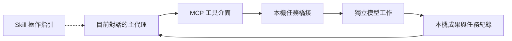

# AI Coop

實驗性的本機 AI 協作橋接：讓目前對話派出有界任務，透過同一個 MCP 入口收回結果，再由主代理查核與整合。

本儲存庫公開泛用的架構程式、操作指引、權限模板與合成測試。它不附帶帳戶、憑證、私人任務、歷史聊天、上游客戶端或模型權重。版本為 **0.1.0**；目前以 macOS／POSIX 與 Python 3.9 以上為支援範圍。

## 架構



| 元件 | 職責 |
| --- | --- |
| `skills/ai-coop/SKILL.md` | 拆解、提供必要上下文、收回與驗收的工作約定 |
| `server.py` | JSON-RPC stdio MCP 介面，提供四個工具 |
| `bridge.py` | 有界背景工作、指紋去重、範圍鎖與結果保存 |
| `coop_config.py` | 通用路徑、執行程式與獨立資料目錄設定 |
| `local_qwen.py` | 按需啟動、核對及停止專用 Ollama 服務 |
| `gemini_tool_guard.py` | 分析與研究工具的執行前限制、稽核紀錄 |
| `verify_release.py` | 公開檔案白名單、內容檢查與 SHA-256 校驗 |

MCP 是工具介面；Skill 是主代理的操作指引。橋接不會監看全部聊天，也不會自行排程。使用其他模型時會建立新的工作階段，只接收派工者明確提供的上下文。子任務不能再呼叫橋接派工。

## 工作模式

| 模式 | 執行入口 | 範圍 |
| --- | --- | --- |
| `analyze` | Claude、Antigravity、Codex、Qwen | 指定的 UTF-8 文字與檔案 |
| `research` | Antigravity | 原生搜尋與明確允許的公開來源 |
| `code` | Claude | 明確提供檔案的獨立副本，由主代理整合 |

`ai_status` 查核本機入口與設定；`ai_submit` 返回任務 ID；`ai_result` 收回狀態與答案；`ai_batch` 提交獨立工作清單。完成的模型輸出標記為 `ready_for_review`，仍須查核來源、差異與必要測試。

雲端模式會把明確提供的任務材料送至選定供應商。本機 Qwen 模式只使用專用 loopback 端點，沒有搜尋或工具呼叫，也沒有靜默的雲端替代。

## 快速開始：先驗證公開內容

取得本儲存庫並在其根目錄執行：

```sh
python3 verify_release.py
python3 -m unittest discover -s tests -q
```

這兩個步驟使用本機程式與合成測試，不需要登入，不執行模型，也不下載依賴。檔案完整性檢查只能確認發布內容；合成測試不能證明供應商或每個 MCP 客戶端的真實往返已成功。

## 設定自己的執行環境

使用者需另外取得官方命令列客戶端，並依各家文件完成本機登入。橋接不提供帳戶，也不代為登入、購買或下載模型。Python 程式只使用標準函式庫。

預設任務資料位於使用者的 `~/.local/state/ai-coop`，與原始碼分離。可設定：

| 環境變數 | 用途 |
| --- | --- |
| `AI_COOP_RUNTIME` | 任務、鎖、備份與本機執行資產目錄 |
| `AI_COOP_CLAUDE_BIN` | 官方 Claude CLI 的路徑 |
| `AI_COOP_GEMINI_BIN` | 官方 Antigravity `agy` CLI 的路徑 |
| `AI_COOP_CODEX_BIN` | 官方 Codex CLI 的路徑 |
| `AI_COOP_PYTHON` | Python 執行程式的路徑 |
| `AI_COOP_PATH` | 子程序使用的執行程式搜尋路徑 |
| `AI_COOP_QWEN_BIN` | 選用的官方 Ollama 執行程式路徑 |
| `AI_COOP_GEMINI_SETTINGS` | 使用者自己的 Antigravity 設定檔 |
| `AI_COOP_GEMINI_AGENTS` | 使用者自己的 Antigravity agent 目錄 |

路徑設定需使用絕對路徑。未設定雲端 CLI 路徑時，程式從本機 PATH 尋找。不同客戶端若要共享去重與排隊，必須使用同一個 `AI_COOP_RUNTIME`。

### MCP

[`examples/mcp.json`](examples/mcp.json) 是空白設定範例。將 `/absolute/path/to/ai-coop/server.py` 替換為本機原始碼位置，依客戶端的設定格式登錄。需要時在 MCP 的 `env` 中加入上述路徑設定；不要放 API key、token 或登入內容。

本版使用 stdio 與傳統 `initialize` 握手，實作的協定版本見 `server.py`。不提供遠端 HTTP 服務，也未宣稱支援所有現行或未來協定版本。已開啟的客戶端可能需要刷新 MCP 連線。

### 命令列

```sh
./bin/ai-coop submit --provider claude --mode analyze --prompt-file examples/task.txt
./bin/ai-coop result TASK_ID
```

以上派工會使用使用者自己的已登入客戶端；不是離線測試。`files` 只接受明確選定的 UTF-8 檔案，不掃描整個專案。PDF、影像與其他格式先由主代理提取必要材料。

### Antigravity 的有界 agent

先執行 `python3 setup_gemini.py` 預覽預定路徑；審閱後以 `python3 setup_gemini.py --install` 產生兩個通用 agent 與對應工具守門設定。不同的既有檔案會被拒絕覆寫。它不複製任何既有帳戶資料，也不自動放寬原生權限。

原生客戶端仍須維持分析／研究所需的限制。橋接會查核有效設定；不符合時回報 `needs_owner`，不繞過拒絕規則。研究正文只讀取明確開放的來源主機；`configure_domains.py add HOSTNAME` 只在使用者明確執行時保存該權限，並在本機資料目錄備份。這是來源權限檢查，不是網路防火牆。

### 本機 Qwen

選用的助手為 `qwen3.5:9b-q4_K_M`，只接受 `analyze`。使用者需另行在資料目錄的 `runtime/ollama/ollama` 與 `models/ollama` 準備相容的官方執行程式與完整模型；本儲存庫不附帶或自動下載它們。

專用端點為 `127.0.0.1:11435`。完整渲染任務上限 12,000 UTF-8 bytes；初始設定為 16K context、最多 2,048 輸出 tokens、關閉 thinking。任務完成或失敗後清理自己啟動的服務；不接管未知服務。模型摘要、量化與回覆完整性須通過檢查。確定性轉換與精確計算仍應交給程式。

## 任務協調與資料保存

全域最多同時執行兩個模型工作，本機 Qwen 同時一個；每批最多 20 個。工作預設 300 秒，可設 30–900 秒。超時、權限、登入與供應商錯誤會保留為可查核狀態，不無限重試。

相同 provider／模式／提示／前次工作／檔案內容會重用已存在的工作。穩定的 `task_key` 不能指向不同輸入，重疊 `scope` 會等待。需要新鮮資料時，請把查詢日期或資料版本納入任務，或由主代理明確使用 `rerun:true`；目前沒有自動有效期限或模型版本失效。

**本機資料目錄會保存使用者提供的任務、檔案副本、模型原始回傳、答案與紀錄。** 私人檔案權限不等於加密，也不能保護遭入侵或共用的帳戶。刪除、保留期限與備份由使用者管理。請閱讀 [SECURITY.md](SECURITY.md)，不要將整個資料目錄納入版本控制、問題回報或公開附件。

## 限制與驗證範圍

- 本次公開版以離線合成測試驗證；沒有把私人執行紀錄當作公開測試證據。
- macOS／POSIX、個人本機使用；不提供 Windows、多租戶、遠端授權或完整安全沙盒保證。
- 供應商 CLI 的旗標、登入方式、模型及原生工具可能變動；應自行做有界真實往返測試。
- Codex 的唯讀沙盒、功能停用與事後事件稽核不能等同於完整零工具隔離。
- Gemini 的原生初始化可能列出較廣工具；執行前守門與實際動作紀錄才是驗收依據。
- 尚無主動取消工具、完整 DAG、跨裝置同步、全聊天共享或自動答案時效管理。

## 來源與授權

本儲存庫原創程式與說明採 [MIT License](LICENSE)。上游客戶端、模型與服務的授權和使用條件各自獨立，不隨本庫授權轉移。來源與整理方式見 [PROVENANCE.md](PROVENANCE.md)，修正方式見 [CONTRIBUTING.md](CONTRIBUTING.md)。
